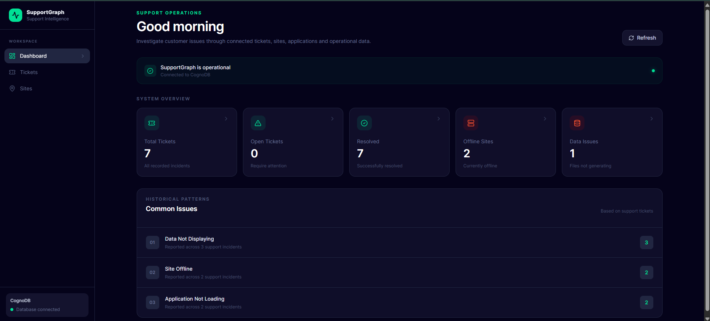
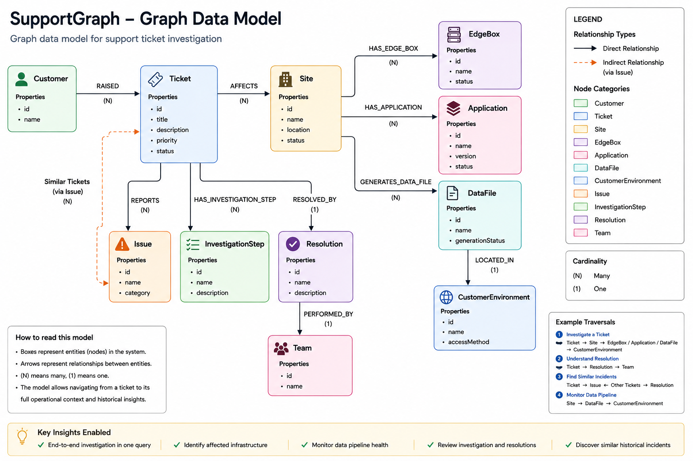
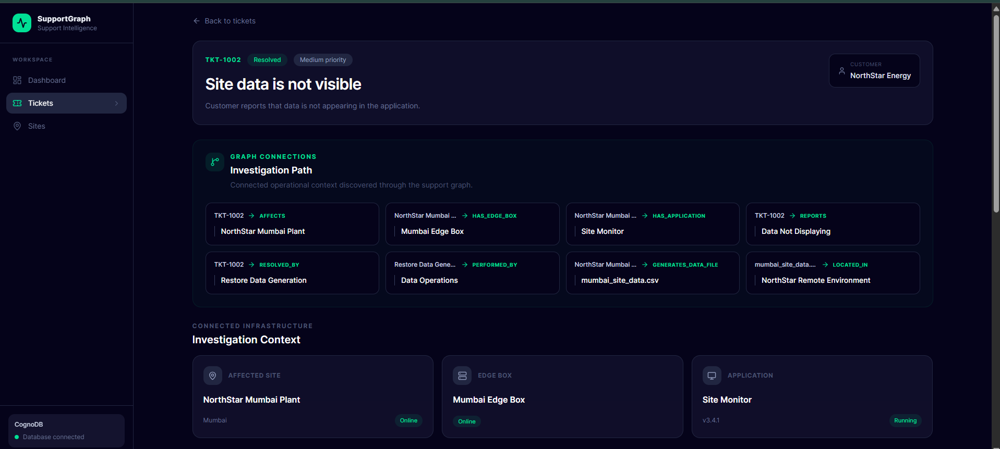
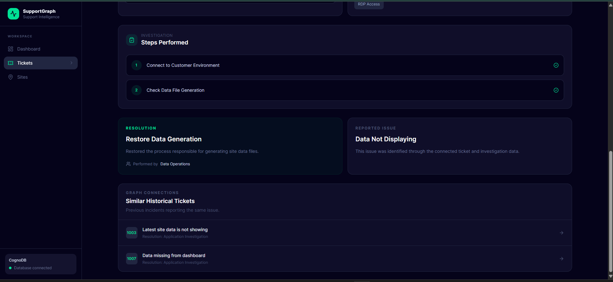
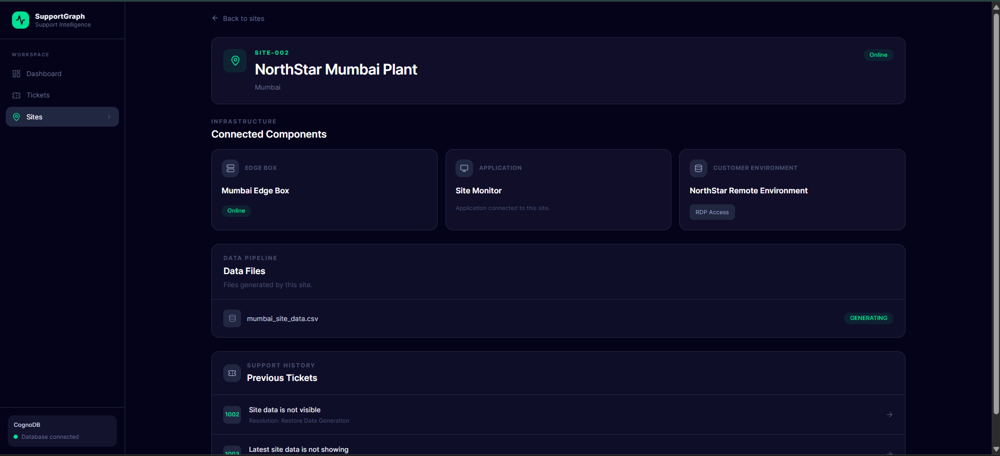

# SupportGraph

**A graph-powered support investigation app — React · FastAPI · CognoDB**

[](https://support-graph.vercel.app)
[](https://react.dev)
[](https://fastapi.tiangolo.com)
[](https://cognodb.com)

Investigating one support incident means assembling a single answer from tickets, sites,
infrastructure, data files, resolutions and teams that usually live in separate screens.

SupportGraph keeps those relationships in a graph, so an engineer starts at a ticket and walks
outward through the connected operational context instead of searching record by record.



**[Try the live demo →](https://support-graph.vercel.app)** — frontend, backend and CognoDB are all
connected. Open any ticket and follow the investigation path.

## Use Case

In a typical support workflow, a ticket may require information from several operational areas before an engineer can determine the cause and resolution.

SupportGraph brings these relationships together so an engineer can start from a ticket and navigate through its connected operational context.

```text
Ticket
  ↓
Affected Site
  ↓
Edge Box / Application / Data Files
  ↓
Customer Environment

Ticket
  ↓
Issue
  ↓
Investigation Steps
  ↓
Resolution
  ↓
Team

Issue
  ↓
Historical Tickets
```

## Why Graph?

A support ticket rarely exists in isolation.

SupportGraph models these connections directly in CognoDB instead of treating tickets, sites, infrastructure, and resolutions as isolated records.

This makes relationship-based investigation straightforward:

- Which site is affected?
- What infrastructure belongs to that site?
- Are the site's data files generating?
- Which investigation steps were performed?
- Which team resolved the issue?
- Have similar incidents happened before?

These relationship traversals are the core reason a graph model is used for this application.

## Features

- Support operations dashboard
- Ticket search and investigation
- Graph-based investigation context
- Site and infrastructure details
- Data generation monitoring
- Historical and similar tickets
- Search across tickets and sites
- FastAPI REST API
- CognoDB graph database
- Reusable React components
- Loading, empty and error states

## Tech Stack

**Frontend**

- React
- JavaScript
- React Router
- Tailwind CSS
- Axios
- Vite

**Backend**

- Python
- FastAPI
- Neo4j Python Driver
- Cypher

**Database**

- CognoDB

## Data Model

The application uses the following main graph entities:

- Customer
- Ticket
- Site
- EdgeBox
- Application
- DataFile
- CustomerEnvironment
- Issue
- InvestigationStep
- Resolution
- Team

### Relationships

```text
Customer
   │
   └── RAISED ──→ Ticket
                     │
                     ├── AFFECTS ──→ Site
                     │                  │
                     │                  ├── HAS_EDGE_BOX ──→ EdgeBox
                     │                  │
                     │                  ├── HAS_APPLICATION ──→ Application
                     │                  │
                     │                  └── GENERATES_DATA_FILE ──→ DataFile
                     │                                                    │
                     │                                                    └── LOCATED_IN ──→ CustomerEnvironment
                     │
                     ├── REPORTS ──→ Issue
                     │
                     ├── HAS_INVESTIGATION_STEP ──→ InvestigationStep
                     │
                     └── RESOLVED_BY ──→ Resolution
                                             │
                                             └── PERFORMED_BY ──→ Team
```

A visual version of the data model is also included below:



## Main Cypher Queries

### Ticket Investigation

The investigation query traverses the ticket's connected graph:

```cypher
MATCH (customer:Customer)-[:RAISED]->(ticket:Ticket {id: $ticket_id})
OPTIONAL MATCH (ticket)-[:AFFECTS]->(site:Site)
OPTIONAL MATCH (site)-[:HAS_EDGE_BOX]->(edge:EdgeBox)
OPTIONAL MATCH (site)-[:HAS_APPLICATION]->(app:Application)
OPTIONAL MATCH (site)-[:GENERATES_DATA_FILE]->(file:DataFile)
OPTIONAL MATCH (file)-[:LOCATED_IN]->(environment:CustomerEnvironment)
OPTIONAL MATCH (ticket)-[:REPORTS]->(issue:Issue)
OPTIONAL MATCH (ticket)-[:HAS_INVESTIGATION_STEP]->(step:InvestigationStep)
OPTIONAL MATCH (ticket)-[:RESOLVED_BY]->(resolution:Resolution)
OPTIONAL MATCH (resolution)-[:PERFORMED_BY]->(team:Team)
```

This provides the support engineer with the customer's ticket, affected infrastructure, data pipeline, investigation history, and resolution in a single query.

### Similar Tickets

Historical tickets are found by traversing through a shared issue:

```cypher
MATCH (current:Ticket {id: $ticket_id})
      -[:REPORTS]->(issue:Issue)
      <-[:REPORTS]-(similar:Ticket)
      -[:RESOLVED_BY]->(resolution:Resolution)

WHERE similar.id <> current.id
```

This allows previous incidents and their resolutions to be surfaced during investigation.

### Dashboard Aggregation

The dashboard uses graph queries to calculate:

- Total tickets
- Open tickets
- Resolved tickets
- Offline sites
- Data files not generating
- Most frequently reported issues

These values are derived directly from the graph rather than maintained as separate counters.

## Project Structure

```text
SupportGraph/
├── backend/
│   ├── app/
│   ├── seed.py
│   ├── requirements.txt
│   ├── .env.example
│   └── .gitignore
│
├── frontend/
│   ├── src/
│   ├── package.json
│   └── .env.example
│
├── docs/
│   ├── data-model.png
│   ├── dashboard.png
│   ├── ticket-investigation.png
│   └── site-details.png
│
└── README.md
```

## CognoDB Setup

1. Create or sign in to your CognoDB Cloud account.
2. Create a new graph database instance.
3. Wait for the instance to become available.
4. Copy the connection URI and database credentials.
5. Add them to `backend/.env`.

```env
COGNODB_URI=
COGNODB_USERNAME=
COGNODB_PASSWORD=
```

The application connects to CognoDB using the Neo4j-compatible Python driver.

## Run Locally

### Backend

```bash
cd backend
python -m venv venv
venv\Scripts\activate
pip install -r requirements.txt
```

Create `backend/.env`:

```env
COGNODB_URI=
COGNODB_USERNAME=
COGNODB_PASSWORD=
```

Seed the database:

```bash
python seed.py
```

Start the API:

```bash
uvicorn app.main:app --reload
```

The API will be available at:

```text
http://localhost:8000
```

FastAPI documentation:

```text
http://localhost:8000/docs
```

### Frontend

```bash
cd frontend
npm install
```

Create `frontend/.env`:

```env
VITE_API_URL=http://localhost:8000
```

Start the application:

```bash
npm run dev
```

## API

```text
GET /api/dashboard

GET /api/tickets
GET /api/tickets/{ticket_id}
GET /api/tickets/{ticket_id}/investigation
GET /api/tickets/{ticket_id}/similar

GET /api/sites
GET /api/sites/{site_id}
```

## Screenshots

### Dashboard


### Ticket Investigation




### Site Details



## Security

Real `.env` files containing database credentials are not committed to the repository.

Use the provided `.env.example` files as templates.
